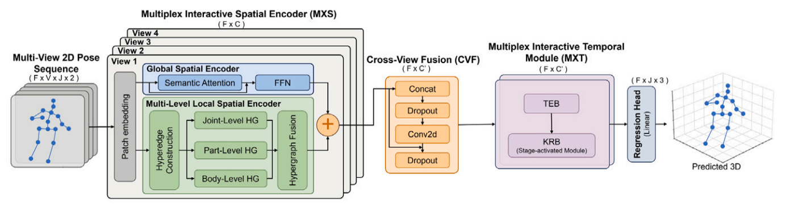
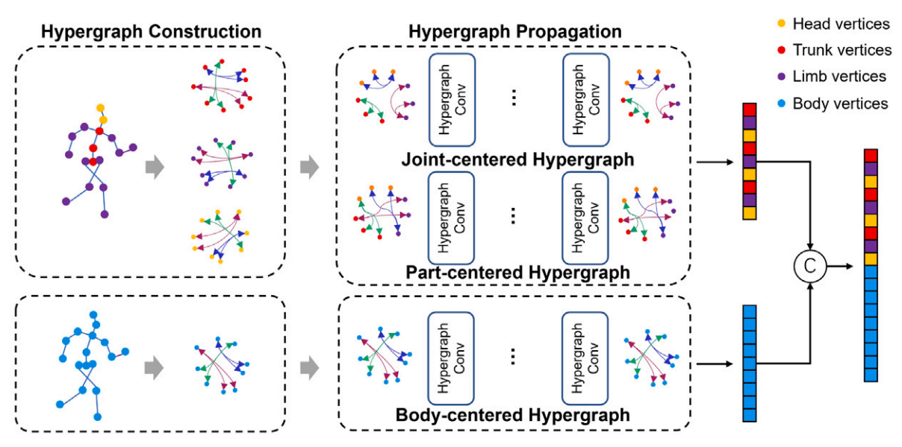
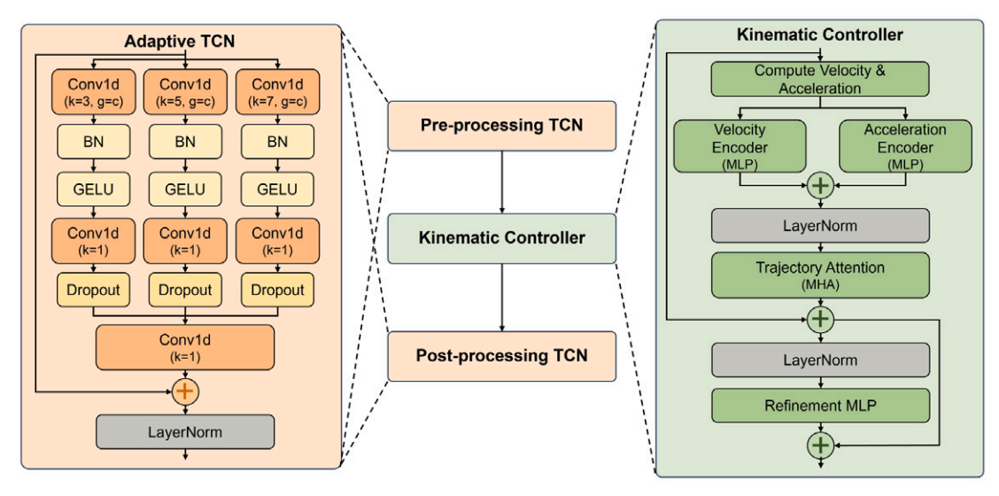
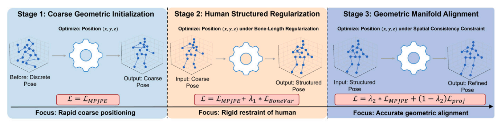

# MXPose: Multiplex Interactive Learning for Multi-View 3D Human Pose Estimation

**Pattern Recognition, Volume 180, 2026, Article 113993**

Wanruo Zhang\*, Zhou Guan\*, Mengyuan Liu, Bin Ren, Hong Liu

\* Equal contribution

[**Paper**](https://doi.org/10.1016/j.patcog.2026.113993) · [**Code**](https://github.com/Jokerealm/MXPose)

MXPose estimates 3D human pose sequences from synchronized multi-view 2D keypoints. It coordinates interactions across **spatial structure, camera views, temporal dynamics, and optimization stages**, combining anatomical priors with learned representations. The pose estimator does not require explicit camera calibration at inference.



*Overall framework from Fig. 2 of the paper.*

## News and roadmap

- [x] MXPose published in **Pattern Recognition**.
- [x] Human3.6M training and evaluation code.
- [ ] Release pretrained checkpoints.
- [ ] Release pose visualization and qualitative comparison tools.
- [ ] Share training curves and experiment logs.

## Method

### Multiplex Interactive Spatial Encoder (MXS)

MXS combines a structural hypergraph stream with a semantic transformer stream. The structural stream models three complementary levels of the body:

- **Joint level:** dynamic, node-centered hyperedges connect joints using feature affinity with a skeletal adjacency bias.
- **Part level:** anatomical groups aggregate and redistribute features to capture coordinated movement of body parts.
- **Body level:** a global body representation provides context for each joint.

The resulting features are fused with global semantic attention and residual connections.

<details>
<summary>Spatial encoder architecture (Fig. 3)</summary>



</details>

### Cross-View Fusion (CVF)

CVF adds view-temporal embeddings and aggregates spatial representations from multiple cameras into a shared representation. A parallel fusion of hop-based geometric features provides structural modulation before temporal modeling.

### Multiplex Interactive Temporal Module (MXT)

MXT has an always-active **Temporal Encoding Branch (TEB)** for long-range temporal attention and a **Kinematic Refinement Branch (KRB)** activated in the second and third training stages. KRB combines adaptive temporal convolutions with kernel sizes 3, 5, and 7, velocity and acceleration cues, and motion-aware attention to refine pose trajectories.

<details>
<summary>Kinematic refinement architecture (Fig. 4)</summary>



</details>

### Progressive Multi-Stage Supervision (PMSS)

PMSS introduces complementary learning objectives progressively:

| Stage | Epochs | Objective | KRB |
| :--- | :---: | :--- | :---: |
| Coarse geometric initialization | 1–35 | MPJPE | Off |
| Human structured regularization | 36–45 | MPJPE + 0.9 × bone-length variation | On |
| Geometric manifold alignment | 46–50 | 0.01 × MPJPE + 0.99 × projection consistency | On |

Bone-length variation regularizes temporal changes in predicted bone lengths. Projection consistency uses a learnable mapping for each view to align predicted 3D joints with the input 2D detections. The implementation uses lightweight view-specific MLPs as training-time projection mappings and compares root-relative projected coordinates with root-relative 2D detections. These mappings are optimized jointly with the pose estimator in Stage 3.



*Progressive supervision from Fig. 5 of the paper.*

## Results reported in the paper

Human3.6M results use a temporal receptive field of **27 frames**. Protocol 1 reports MPJPE; Protocol 2 reports Procrustes-aligned MPJPE. Errors are in millimeters, and lower is better.

| 2D input | P1 / MPJPE ↓ | P2 / PA-MPJPE ↓ | Source |
| :--- | ---: | ---: | :--- |
| CPN detections | **27.1** | **21.4** | Tables 1 and 4 |
| Ground-truth keypoints | **11.3** | — | Table 1 |

These are the published experimental results. The paper also evaluates MXPose on MPI-INF-3DHP and Ski-Pose; see the paper for the complete comparisons and ablations.

## Getting started

### Installation

Use Python 3.10–3.12 and install the dependencies:

```bash
git clone https://github.com/Jokerealm/MXPose.git
cd MXPose
python -m venv .venv
source .venv/bin/activate
python -m pip install -r requirements.txt
```

A CUDA-capable GPU is recommended for training. Install a PyTorch build compatible with your environment.

### Human3.6M data preparation

Prepare Human3.6M using the [VideoPose3D dataset instructions](https://github.com/facebookresearch/VideoPose3D/blob/main/DATASETS.md#human36m), including its [CPN 2D detections](https://github.com/facebookresearch/VideoPose3D/blob/main/DATASETS.md#2d-detections-for-human36m). The loader expects the standard preprocessed NumPy archives:

```text
/path/to/h36m/
├── data_3d_h36m.npz
└── data_2d_h36m_cpn_ft_h36m_dbb.npz
```

The standard split uses **S1, S5, S6, S7, and S8** for training and **S9 and S11** for evaluation. The loader selects the standard 17-joint skeleton and combines synchronized observations from all four cameras. The 3D archive stores world coordinates in meters; the loader makes these root-relative. The 2D archive stores pixel coordinates, which are normalized using each camera's image dimensions. Keep the standard camera order: `54138969`, `55011271`, `58860488`, `60457274`.

### Training

```bash
python main.py \
  --data-root /path/to/h36m \
  --frames 27 \
  --batch-size 1024 \
  --epochs 50
```

The default configuration uses AdamW with AMSGrad, an initial learning rate of `0.0002`, an epoch-wise learning-rate decay of `0.98`, and weight decay of `0.1`. PMSS changes stages after epochs 35 and 45. Reduce `--batch-size` to fit the available GPU memory.

To train on multiple GPUs, select them with `CUDA_VISIBLE_DEVICES` and add `--data-parallel`. The batch size is the total across the selected devices.

To resume a training run, including its optimizer and progressive supervision state:

```bash
python main.py \
  --data-root /path/to/h36m \
  --resume checkpoint/last.pth
```

The checkpoint restores the architecture, curriculum, optimizer, and random states. Saved data-sampling settings and batch size are reused unless explicitly overridden on the command line; dataset paths and device selection can be changed for the current machine.

### Evaluation

```bash
python main.py \
  --data-root /path/to/h36m \
  --evaluate checkpoint/best.pth
```

Evaluation restores the model configuration and PMSS stage saved in the checkpoint and reports P1 and P2 for each action and their average.

For ground-truth 2D inputs, prepare `data_2d_h36m_gt.npz` following the same dataset instructions and add `--keypoints gt` when training or evaluating the corresponding model.

Run `python main.py --help` for the complete list of options.

### Checks

Run the model, data-loading, metric, and supervision checks with:

```bash
python -m unittest discover -s tests -v
```

## Citation

If you use MXPose in your research, please cite:

```bibtex
@article{zhang2026mxpose,
  title   = {{MXPose}: Multiplex interactive learning for multi-view {3D} Human Pose Estimation},
  author  = {Zhang, Wanruo and Guan, Zhou and Liu, Mengyuan and Ren, Bin and Liu, Hong},
  journal = {Pattern Recognition},
  volume  = {180},
  pages   = {113993},
  year    = {2026},
  doi     = {10.1016/j.patcog.2026.113993}
}
```

## Acknowledgements

We thank the authors of [VideoPose3D](https://github.com/facebookresearch/VideoPose3D) for the Human3.6M preprocessing tools and 2D pose detections.
